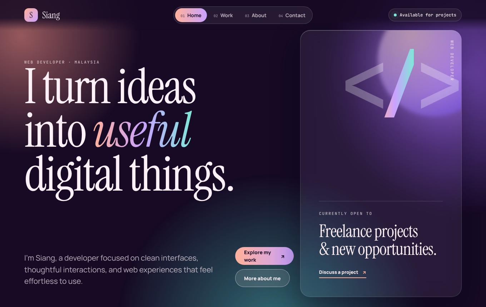

# Siang Portfolio

A responsive SvelteKit portfolio for Siang. It is designed to present his front-end work clearly to potential clients and employers across four connected pages: Home, Work, About, and Contact.

## Preview



## Refurbished layout

The portfolio uses the **Dusk Glass** design. Every page is a run of full-colour chapters, and a fixed backdrop blends between each chapter's colour and texture as you scroll. Panels are frosted glass, headlines are light serif with gradient italics, and the accents are peach, lilac, and mint. The pages, copy, projects, and links are unchanged.

- Light serif headlines (Instrument Serif) with gradient italic accents, Manrope body text, and JetBrains Mono labels
- Scroll-driven backdrop that blends colour and texture (dots, stripes, grid, half-tone, waves, mesh, aurora, grain) per chapter, with a progress bar and chapter label
- Word-by-word text reveals, drifting background words, stacked project cards, a self-drawing timeline, and a colour curtain between pages
- Every project on the Work page gets its own colour chapter (set in `src/lib/projects.js`)
- Frosted glass cards and panels
- Clear typography and stronger content hierarchy
- Focused calls to action for viewing projects and making contact
- Curated front-end project cards with live and source links
- An About page with education, capabilities, résumé, and certificate links
- Responsive layouts for desktop, tablet, and mobile screens
- Accessible semantic structure and reduced-motion support (motion, reveals, and the curtain are skipped)

The `main` branch contains the publish-ready website. Future layout experiments can continue on `feature/siang-portfolio-prototype` before being reviewed and merged into `main`.

## Stack

- SvelteKit and Vite
- Tailwind CSS 3 with documented custom component styles
- Responsive, accessible semantic HTML

## Run locally

```bash
npm install
npm run dev
```

## Quality checks

```bash
npm run lint
npm run build
```

Project information is maintained centrally in `src/lib/projects.js`. Global design primitives and responsive component styles live in `src/app.css`, and the scroll effects live in `src/lib/dusk.js`. The contact form is intentionally a local prototype interaction and does not transmit data.
